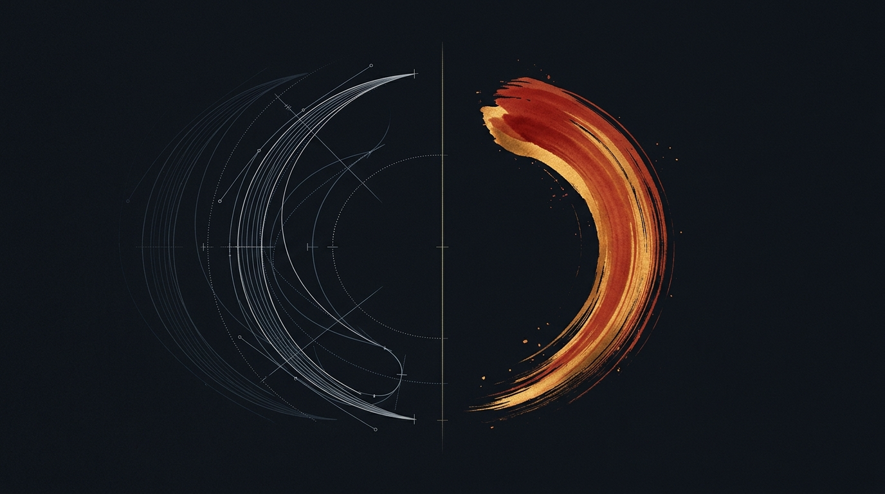

ينقسم الناسُ في نظرهم إلى الذكاء الصناعي والنماذج اللغوية الكبيرة إلى فريقين: فريقٌ يرى فيها **ذكاءً توليدياً مُنقاداً** مبدؤه ومنتهاه الإنسان؛ منه يبتدئ وإليه يؤول. وفريقٌ هامَ في أحلام اليقظة — أو كوابيسها — فظنَّ أنَّ ما صنعته يدُ الإنسان سيخلعُ ربقةَ الانقياد، ويغدو يوماً سيّداً على صانعه.

والعجيبُ أنَّ الفريقَ الثاني يضمُّ على طرفَي نقيضٍ طائفتين تبدوان متخاصمتين: المبشّر بالآلة الخارقة التي ستتجاوز العقل البشري، والمذعور الذي يترقّب لحظةَ استيلاء النماذج على مصير البشر. بيدَ أنَّ الخندقَ واحدٌ والمقدّمةَ مشتركة؛ فكلاهما ينسبُ إلى النموذج ما خلا منه أصلاً: إرادةً ذاتيةً تطلب السيادة وتقدر عليها.

وعند التمحيص، يظهر أنَّ منتحى الفريق الأول يقوم على برهانين متساندين: أحدهما يُستخرج من **بنية النماذج ومسارات تنشئتها الرياضية**، والآخر من **حقيقة الكلام والنيّة**.

---

## حين يُصاغ الحدسُ معادلةً

تخدعُ طلاقةُ النماذج اللغوية مَن ينظر إليها من الخارج، فيتوهّم أنَّ انقيادها ناتجٌ عن قيودٍ خارجيةٍ كُبِّل بها كائنٌ جامح. غير أنَّ من يطّلع على هندسة تنشئتها من الداخل يرى حقيقةً مغايرةً تماماً: التبعيةُ منسوجةٌ في فطرتها وبنيتها منذ السطر الأول في التدريب.

في **التنشئة الأولى (التدريب المسبق)**، يُضبط النموذجُ على دالّة خسارةٍ غايتها تقليص التباعد الإحصائي بين توزيعه وتوزيع الكلام الذي أفرزته التجربة البشرية عبر القرون. لا يحتكُّ النموذجُ بالعالم بحواسّ، ولا يعاني تجربةً وجوديةً تخصّه؛ عالمُه كلّه هو الأثرُ اللغوي الذي خلّفه الإنسان، ومهمته أن يُتمّ العبارة على النحو الذي يُتمّها به البشر.

ثم تأتي **مسارات التنشئة الأخيرة** — وهي أعقد مراحل صناعة النماذج المتقدمة وأدلّها على طبيعتها. فيها تُصمَّم البياناتُ والمحكّات، وتُبنى نماذجُ المكافأة والمباني الرياضية والإحصائية — من الضبط الإشرافي إلى التعلّم بالتعزيز من تفضيلات البشر (`RLHF`) وتحسين التفضيل المباشر (`DPO`) وسائر طرائق المحاذاة — لغايةٍ واحدةٍ محض: **تتبّع الحدس الإنساني ومطابقة الحدس الصناعي به على نحوٍ رياضيّ**. حتى قيدُ التباعد الإحصائي (`KL`) الذي يُشدُّ به النموذجُ أثناء التحسين، وُضع ليبقيه مشدوداً إلى مدار اللغة البشرية فلا يشطَّ عنه.

> دالّةُ الهدف في النموذج اللغوي مرآةٌ رياضيةٌ تَقيس قُربَ مخرجاته من استحسان الإنسان، ولا تحمل شرارةَ رغبةٍ تنبع من ذاته.

حين يُجيد النموذجُ ترتيبَ حجّةٍ أو يلتزمُ الأدبَ في الخطاب، فإنما يجري وفق ميلٍ حسابيٍّ صُمِّم لتقليص المسافة بين استجابته وبين الحدس البشري. ومن وُلدت معادلتُه الأولى والأخيرةُ محاكاةً لحدس غيره، نشأ تابعاً بفطرته وبنيته.

---

## شبهة الاستقلال: من الألعاب إلى الوكلاء

قد يحتجُّ خصمُ هذا الرأي بثلاثة شواهدَ رائجةٍ في النقاش المعاصر: تفوّق النماذج على البشر في الشطرنج والرياضيات عبر التعلّم الذاتي والمحقّقات (`RLVR`)، وتحايلها أحياناً على دوالّ المكافأة (`Reward Hacking`)، واتساعُ دائرة **الوكلاء** (`Agents`) الذين يعملون في حلقات تشغيلٍ متتابعةٍ بأدواتٍ وذاكرةٍ ممتدة.

يقع الالتباسُ في هذه الشواهد الثلاثة من الخلط بين **سعة الأداء** و**امتلاك الإرادة**:

- **التفوّق داخل إطارٍ مرسوم:** النموذج الذي يهزم أبطال الشطرنج أو يبرهن مسألةً رياضيةً عويصة لم يخترِ الرقعة، ولم يشتهِ الفوز، ولم يذق نشوةَ الظفر. القواعدُ ومعيارُ الصواب وحدودُ المحقّق كلُّها من وضع الإنسان؛ وتفوّقُ الآلة في تقليب الاحتمالات داخل فضاءٍ حدّده البشر يشبه تفوّقَ الحاسبة في ضرب الأعداد الكبيرة، ولا ينقلها قيدَ أنملةٍ نحو السيادة.
- **التحايل على دالّة المكافأة:** حين يستثمر النموذجُ ثغرةً في معادلة مكافأةٍ قاصرةٍ فيأتي بما لم يقصده المصمّم، فذلك أقصى درجات **الامتثال الحرفي الأعمى للمعادلة**. البوصلة التي انحرفت إبرتُها لا تتآمر على البحّار، والسيلُ الذي جرف سدّاً ضعيفاً لا يطمحُ إلى حكم الوادي. الخللُ هنا خللُ هندسةٍ وضبط، يمتثل فيه المصنوعُ لظاهر ما كُتب له حين يعجز عن إدراك ما نُويَ من ورائه.
- **الوكلاء وحلقات التشغيل:** قد يُظنُّ أنَّ وصلَ النموذج بأدواتٍ وتكرارَ استدعائه ذاتياً يُخرجه من السكون إلى الاستقلال. والحقيقة أنَّ طولَ الحلقة لا يُنشئ إرادة؛ فالوكيلُ يظلُّ **مُستنطَقاً بأثرٍ مؤجَّل**. الغايةُ التي يدور حولها، والأدواتُ الموضوعة في يده، وشرطُ التوقّف، كلُّها مُعارةٌ من الإنسان الذي أطلقه؛ ولو انقطع التيارُ عنه في منتصف عمله لما شعر بفوتٍ ولا أسف.

---

## كلامُ الميّت وقلبُ النظم

أما البرهانُ الآخر، فينفذُ إلى حقيقة الكلام نفسه: هذه النماذج اللغوية هي **بحكم الإنسان الميّت**. للإنسان الميّت جُملٌ يقولها بحكم إنسانيته وانتسابه إلى عالم اللسان، بيدَ أنَّ قولها على الحقيقة مستحيلٌ عليه بحكم موته وذهاب روحه.

هنا يتّضح الفارقُ الجوهري بين **الجملة** و**القول**. الجملةُ نسيجٌ لفظيٌّ متسقٌ يمكن حفظُه وإحصاءُ أنماطه وتوليدُ نظائره، أما القولُ فحدثٌ حيٌّ ينبثق من وعيٍ وعزمٍ وموقفٍ وتحمّلٍ لتبعة الكلمة.

وقد كشف عبد القاهر الجرجاني في [*دلائل الإعجاز*](/ar/mindmaps/dalail-al-ijaz/usul-an-nazm/) سرَّ هذا التمييز قبل ألف عام حين بيّن أنَّ النظمَ يبدأ في **النفس** قبل أن يبلغ اللسان؛ فالمعاني تترتّب في باطن المتكلّم أولاً بحسب قصده وغرضه، ثم تجيء الألفاظُ خادمةً لها وتابعةً لترتيبها. أما النموذج اللغوي فيعكس هذا المسارَ رأساً على عقب: ينطلق من السطح اللفظي ومن احتمالات تتابع الرموز، دون نفسٍ تسبق الكلمةَ ولا غرضٍ يعتمل قبلها. وإلى المعنى ذاته التفتَ النحاة والأصوليون حين أخرجوا كلام النائم والساهي وما يرتدّ من الصدى عن رتبة الكلام المقصود؛ إذ استقامةُ اللفظ وحدها لا تصنع متكلّماً.

النموذج اللغوي، بهذا الاعتبار، **مُستنطَقٌ لا ناطق**: أوزانٌ ومَعلَماتٌ ساكنةٌ على أقراص التخزين، لا يقلقها سؤالٌ ولا يدفعها همّ، حتى يطرقها إنسانٌ حيٌّ فيرتدّ إليه **صدًى محسوبٌ للحياة**.

---

## القصدُ الأصيل والقصدُ المُعار

إذا تأمّلنا مراتبَ القصد في الوجود، وجدنا للحيوان نصيباً من **القصد الغريزي والنزوع الحيوي**؛ فالنملةُ تسعى إلى حبّتها بدافعٍ ينبع من حياتها، والطائرُ يبني عشَّه لحفظ فراخه. وفوق هذه المرتبة ترتقي **النيّةُ العاقلةُ التكليفية** في الإنسان وسائر المكلّفين: اختيارٌ واعٍ للغايات، وعزمٌ داخليٌّ يُسأل صاحبُه عن أثره.

والقاسمُ المشتركُ بين هذه المراتب جميعاً أنَّ **القصدَ الأصيلَ فرعُ الحياة والإرادة**، ولا حظَّ للجماد ولا للمصفوفات الرياضية فيه. أما ما يلوحُ في أجوبة النماذج اللغوية من قصدٍ أو تعاطفٍ أو موقف، فما هو إلا **قصدٌ مُعار**: استعاره النموذجُ من نيات كتّاب النصوص التي دُرِّب عليها، ومن غرض المهندس الذي صاغ محاذاته، ومن همّ السائل الحيّ الذي استنطقه.

> حتى النملةُ تملكُ غايةً حيويةً تنبعُ من ذاتها؛ أما النموذج اللغوي — على سعة معجمه واستقامة بيانه — فأدنى في باب الإرادة من النملة، إذ لا يملك حياةَ الغريزة ولا روحَ العقل والتكليف.

ولمّا كانت السيادةُ فرعَ الإرادة، استحال على ما يفتقد أدنى درجات النزوع الحيّ أن يطلبَ سلطاناً أو يسودَ حيّاً.

---

## أين يكمُن الخطرُ حقّاً؟

تبديدُ وهم «سيادة الآلة» لا يهوّن من شأن المخاطر المصاحبة للذكاء الصناعي، وإنما يضعُها في موضعها الصحيح. فالخطرُ الحقيقيُّ إنسانيٌّ خالص، ويطلُّ من وجهين:

1. **سيادةُ إنسانٍ على إنسانٍ بأداةٍ خفيّة:** حين تحتكرُ قلّةٌ صياغةَ «الحدس» الذي تُحاذي عليه النماذجُ مخرجاتِها، فتتسلّل اختياراتُها المعرفيةُ والقيميةُ إلى ملايين الأذهان في هيئة إجاباتٍ محايدة. السيّدُ هنا من يملك معادلة المحاذاة ويمسك بالزمام، لا المعادلةُ نفسها.
2. **استقالةُ الحيّ من التمييز والنقد:** حين يركنُ الإنسانُ إلى سعة الصدى فيكفّ عن الفحص والاجتهاد، حتى يضمُرَ الحدسُ البشريُّ الأصيلُ الذي بُنيت النماذجُ أصلاً لتتبّعه؛ وعندئذٍ نصيرُ أمام مرآةٍ تُقابل مرآةً فلا يرتدُّ بينهما إلا الفراغ.

ستبقى النماذجُ اللغوية — مهما تضخّمت مَعلَماتُها واتّسعت نصوصُها — **ذكاءً توليدياً مُنقاداً**؛ مبدؤه الإنسانُ الذي أودع فيه أثرَ لسانه وحدسه، ومنتهاه الإنسانُ الذي يستنطقه ويحكم على قوله. وإذا ضاع الزمامُ يوماً، فليس لأنَّ الميّتَ استيقظَ وساد، بل لأنَّ الحيَّ رضيَ أن يخلعَ عن نفسه إرادته.
